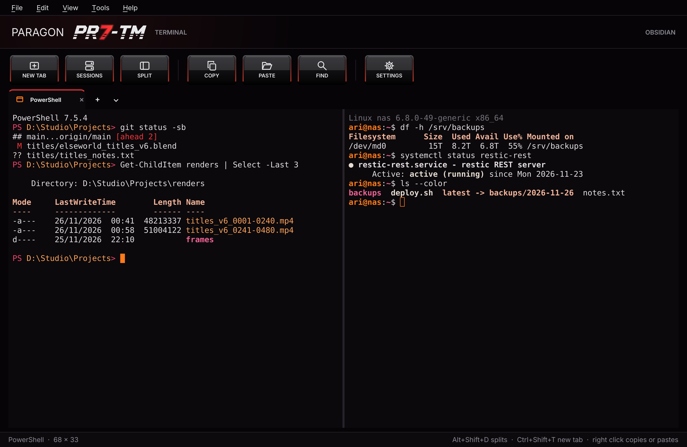
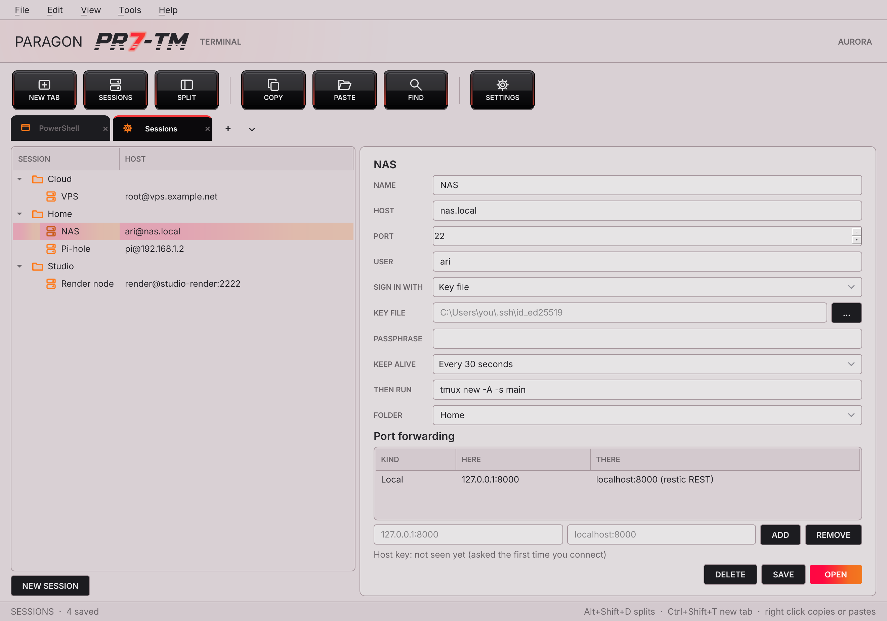

# Paragon PR7-TM

A terminal that works the way **Windows Terminal** and **PuTTY** work, in the Paragon family look (PR7-Z ... PR7-HW,
PR7-BK). Python and PySide6.

## What it does

- **Tabs and split panes.** Windows Terminal's keys:

  | Key | What it does |
  |---|---|
  | Ctrl+Shift+T | New tab with the default shell |
  | Ctrl+Shift+1..9 | New tab with that profile |
  | Alt+Shift+D | Split the pane |
  | Alt+Shift+= / Alt+Shift+- | Split right / split down |
  | Alt+arrow | Move between panes |
  | Ctrl+Shift+W | Close the pane |
  | Ctrl+Tab | Next tab |
  | Ctrl+Shift+F | Find |
  | F11 | Full screen |

- **This PC's shells:** PowerShell 7, Windows PowerShell, Command Prompt, each WSL distribution and Git Bash are found
  by themselves. They run through Windows' own console API (ConPTY), so full-screen programs (vim, htop, tmux)
  behave as in Windows Terminal. "As administrator" opens an administrator window.
- **SSH and saved sessions, as in PuTTY:**
  - sessions in folders, each with host, port and user;
  - signing in with a key file (with its passphrase), a password, or the SSH agent;
  - keep-alive, a command to run after connecting, and port forwarding (`ssh -L`);
  - Quick connect (Ctrl+Shift+N) takes `user@host:port`.
- **Host keys and passwords:** a new server's key is shown before anything is sent. A changed key is refused, as
  PuTTY does. Passwords and passphrases are kept in Windows' Credential Manager, never in PR7-TM's files.
- **Mouse and clipboard:**
  - drag selects, double click selects a word;
  - right click copies the selection, or pastes when nothing is selected;
  - Ctrl+C copies when something is selected, otherwise it reaches the program;
  - Ctrl+V pastes; multi-line pastes don't run line by line in shells that support bracketed paste.
- **Scrollback** of 10,000 lines (adjustable) with Find, font size with Ctrl+wheel. When a program ends,
  Enter closes the pane and R starts it again.
- **Family colours:** what programs show in green, blue, cyan or purple appears in the family's pearl, pink, peach
  and red. That covers the 16 standard colours, the 256-colour palette and exact colours.

## Building

`pip install -r requirements.txt -r requirements-dev.txt`, `python -m pytest`, `pyinstaller pr7tm.spec`, then Inno Setup:
`iscc /DAppVersion=x.y.z installer\pr7tm.iss`.
